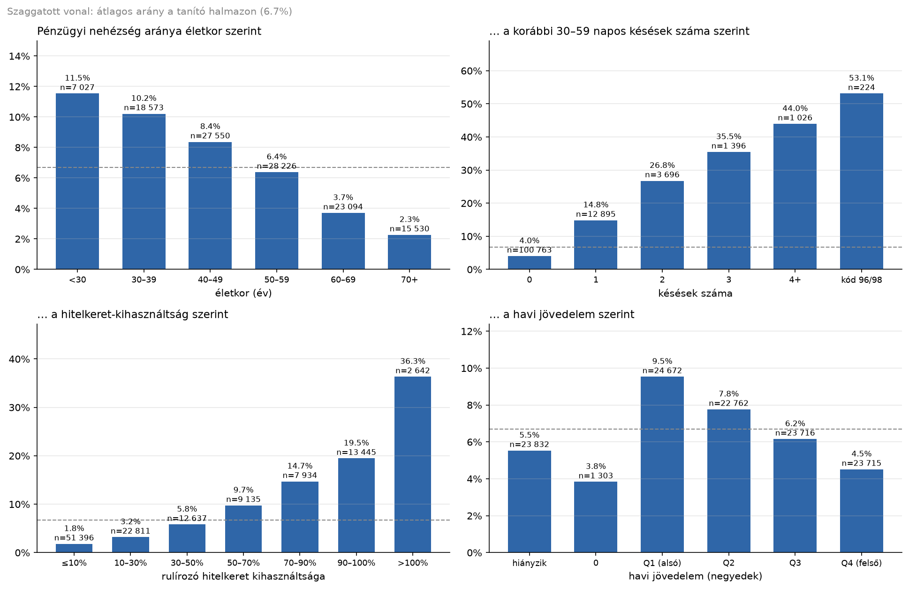
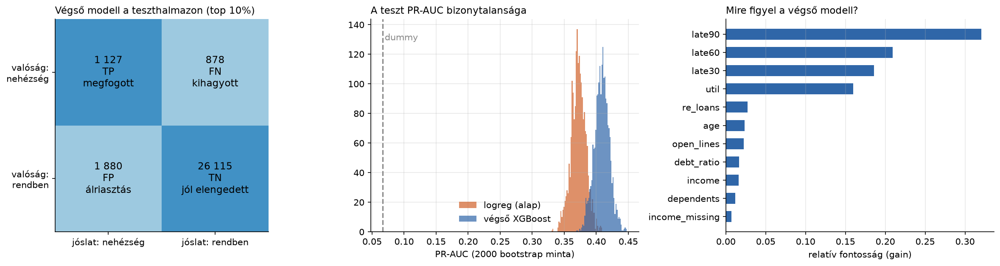

# Ki kerül pénzügyi nehézségbe? Bináris klasszifikáció a „Give Me Some Credit” adaton

**Adat:** Kaggle „Give Me Some Credit” (OpenML 46929), 150 000 hitelfelvevő, 10 változó. **Cél:** az ügyfél két éven belül 90+ napos késedelembe esik-e (pozitív arány: 6,7%). Részletek, kód és minden szám: `hazi4_klasszifikacio.ipynb`.

**Hipotézis.** A hitelkérelem idején ismert adatokból a súlyos késedelem jól rangsorolható. A legerősebb jel a korábbi késéstörténet és a hitelkeret-kihasználtság, a fiatalabb és alacsonyabb jövedelmű ügyfelek pedig kockázatosabbak. A második hipotézis az volt, hogy két oszlopból számolt jellemzők (havi adósság összege, egy főre jutó jövedelem, összes késés) javítják a modellt.

**Fő változók és amit az adat mutat.** A kockázat az életkorral meredeken csökken (<30 év: 11,5%, 70+: 2,3%). Egyetlen korábbi 30 napos késés 4%-ról 15%-ra emeli, 90% fölötti hitelkeret-kihasználtság pedig 20–36%-ra. Két adathiba is előkerült: a késés-oszlopokban a 96/98-as érték kód, nem darabszám (itt 53% a pozitív arány); a hiányzó jövedelmű sorokban (20%) pedig a DebtRatio az adósság *összegét* tartalmazza, nem az arányát. A jövedelem hiánya jel, nem szivárgás, mert a kérelemkor már ismert, ezért jelzőként megtartottam.

**Módszer.** Először zárolt, rétegzett 20%-os teszthalmaz, utána minden döntés csak a tanító halmazon, közös 5-foldos keresztvalidációval. A mutatókat előre rögzítettem: PR-AUC, kiegyensúlyozott pontosság, és a legkockázatosabb 10% találati aránya (a bank feltételezett átvilágítási kapacitása). A nyers pontosságot elvetettem, mert a „senki sem kerül bajba” modell is 93%-os. Modell-létra (PR-AUC): dummy 0,067 → logreg 0,360 → döntési fa 0,353 → random forest 0,395 → **XGBoost 0,399**.

**Visszacsatolási kör.** A kihagyott pozitívak 69%-ának nincs késéstörténete: a modell számára láthatatlanok. A három új jellemző az XGBoostnak **nem segített** (a legjobb +0,002 ± 0,003, a zajon belül). A logisztikus regressziónak a DebtRatio szétválasztása kicsit, de mind a 10 foldon javított. A hangolás nyeresége (+0,002 ± 0,002) sem lépte át az előre rögzített küszöböt, ezért az egyszerűbb modell maradt.

**Eredmény a teszten (egyszer).** XGBoost PR-AUC **0,408 [95% CI 0,384–0,432]**, szemben a logreg 0,372-vel. A páros bootstrap-különbség +0,036 [+0,026; +0,048]. A kérelmek legkockázatosabb 10%-ának átvilágításával a később bajba kerülők **56%-a** megfogható, 37,5%-os találati aránnyal. **Korlátok:** nincs időbélyeg (időbeli validáció nem lehetséges), a hibák nagy része a meglévő oszlopokból nem javítható, a költségarány és a 10%-os kapacitás feltevés.
